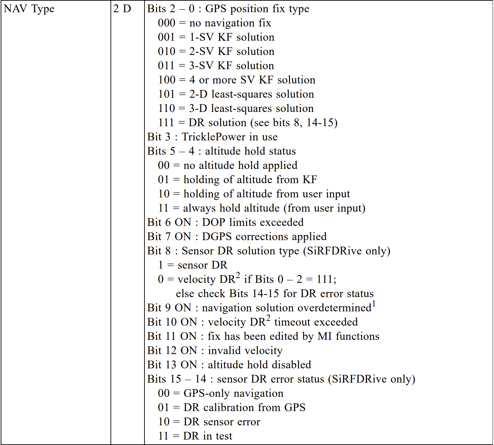

## SBN - SiRF Binary

This format is only generated by the Locosys GT-11 and GT-31.


### Locosys Header

SBN and SBP files typically start with a file header which includes username, serial number, log rate, and firmware version.

From the Locosys documentation for V1.61(B0815a), but be aware that `MID_FILE_ID(0xfd)` is shorthand.

```
- New SBP header file is defined as follows :
 	BYTE 0 ~1 : real SBP header length 
 	BYTE 2~63:  MID_FILE_ID(0xfd) with following payload :
                       User Name, Serial Number, Log Rate, Firmware Version
			>field separator:","
			>User Name : MAX CHAR(13)
			>Serial Number : MAX CHAR(8)
			>Log Rate : MAX CHAR 3, 0..255 in seconds
			>Firmware Version  :  MAX CHAR (14) , V1.62(B0820T)
```

This is an example of a genuine SBP header:

```
00000000: 2600 a0a2 001e fd4b 3838 382c 3833 3230  &......K888,8320
00000010: 3034 3439 342c 312c 5631 2e34 2842 3038  04494,1,V1.4(B08
00000020: 3033 5429 0712 b0b3 ffff ffff ffff ffff  03T)............
00000030: ffff ffff ffff ffff ffff ffff ffff ffff  ................
```

Annotations using my [Python code](https://github.com/Logiqx/gps-wizard/blob/main/python/readers/sirf_reader.ipynb) as reference:

| length  | item           | value         | comment                                                      |
| ------- | -------------- | ------------- | ------------------------------------------------------------ |
| 2 bytes | true length    | little endian | payload length + 8 bytes = start token (2 bytes) + payload length (2  bytes) + payload + checksum (2 bytes) + end token (2 bytes) |
| 2 bytes | start token    | 0xa0a2        |                                                              |
| 2 bytes | payload length | little endian | payload length can be an even or odd number of bytes         |
| n bytes | payload        | 0xfd …        | First byte of the payload is the "message ID" (0xfd)         |
| 2 bytes | checksum       | big endian    | Simply add all of the unsigned bytes in the payload, including the 0xfd |
| 2 bytes | end token      | 0xb0b3        |                                                              |
| …       | padding        | 0xff          | Padding to make header 64 bytes                              |

Notes:

- The payload includes message ID (0xfd), User Name, Serial Number, Log Rate, Firmware Version.
  - Locosys defined the serial number is MAX CHAR(8), so 3 bytes of a MAC address be be used as CHAR(8).


### Geodetic Navigation Data - Message ID 41

The SiRF binary format consists of 91 to 97 byte messages which mainly originate from the Geodetic Navigation Data.

The first 91 bytes are standard SiRF and remaining bytes are specific to Locosys; unfiltered SOG + COG, SDOP and VSDOP.

SiRFDrive fields are always set to zero on the GT-11 and GT-31, so they can safely be ignored.

| SiRF Name                                         | Raw Name             | Type | Name  |  Type   | Units |     Resolution      |
| ------------------------------------------------- | -------------------- | :--: | :---: | :-----: | :---: | :-----------------: |
| Message ID <sup>1</sup>                           | message_id           |  u1  |   -   |    -    |   -   |          -          |
| Nav Valid <sup>2</sup>                            | nav_valid            | >u2  |   -   |    -    |   -   |          -          |
| Nav Type <sup>3</sup>                             | nav_type             | >u2  |   -   |    -    |   -   |          -          |
| Extended Week Number                              | extended_week_no     | >u2  |   -   |    -    |   -   |          -          |
| TOW                                               | time_of_week         | >u4  |   -   |    -    |   -   |          -          |
| UTC Year                                          | utc_year             | >u2  |  ts   | float64 |   s   | 1 x 10<sup>-3</sup> |
| UTC Month                                         | utc_month            |  u1  |  ts   | float64 |   s   | 1 x 10<sup>-3</sup> |
| UTC Day                                           | utc_day              |  u1  |  ts   | float64 |   s   | 1 x 10<sup>-3</sup> |
| UTC Hour                                          | utc_hour             |  u1  |  ts   | float64 |   s   | 1 x 10<sup>-3</sup> |
| UTC Minute                                        | utc_minute           |  u1  |  ts   | float64 |   s   | 1 x 10<sup>-3</sup> |
| UTC Second                                        | utc_millisecs        | >u2  |  ts   | float64 |   s   | 1 x 10<sup>-3</sup> |
| Satellite ID List                                 | sv_ids               | >u4  | svids | uint32  |   -   |          -          |
| Latitude                                          | latitude             | >i4  |  lat  | float64 |  deg  | 1 x 10<sup>-7</sup> |
| Longitude                                         | longitude            | >i4  |  lon  | float64 |  deg  | 1 x 10<sup>-7</sup> |
| Altitude from Ellipsoid                           | altitude_ellipsoid   | >i4  |   -   |    -    |   -   |          -          |
| Altitude from MSL                                 | altitude_msl         | >i4  |  ele  | float64 |   m   | 1 x 10<sup>-2</sup> |
| Map Datum <sup>4</sup>                            | map_datum            |  u1  |   -   |    -    |   -   |          -          |
| Speed Over Ground (SOG)                           | sog                  | >u2  |  sog  | float32 |  m/s  | 1 x 10<sup>-2</sup> |
| Course Over Ground (COG, True)                    | cog                  | >u2  |  cog  | float32 |  m/s  | 1 x 10<sup>-2</sup> |
| Magnetic Variation <sup>5</sup>                   | magnetic_variation   | >i2  |   -   |    -    |   -   |          -          |
| Climb Rate                                        | climb_rate           | >i2  |  roc  | float32 |  m/s  | 1 x 10<sup>-2</sup> |
| Heading Rate - SiRFDrive                          | heading_rate         | >i2  |   -   |    -    |   -   |          -          |
| Estimated Horizontal Position Error               | ehpe                 | >u4  | ehpe  | float32 |   m   | 1 x 10<sup>-2</sup> |
| Estimated Vertical Position Error                 | evpe                 | >u4  | evpe  | float32 |   m   | 1 x 10<sup>-2</sup> |
| Estimated Time Error - SiRFDrive                  | ete                  | >u4  |   -   |    -    |   -   |          -          |
| Estimated Horizontal Velocity Error - SiRFDrive   | ehve                 | >u2  |   -   |    -    |   -   |          -          |
| Clock Bias <sup>6</sup>                           | clock_bias           | >i4  |   -   |    -    |   -   |          -          |
| Clock Bias Error - SiRFDrive                      | clock_bias_error     | >u4  |   -   |    -    |   -   |          -          |
| Clock Drift <sup>6</sup>                          | clock_drift          | >i4  |   -   |    -    |   -   |          -          |
| Clock Drift Error - SiRFDrive                     | clock_drift_error    | >u4  |   -   |    -    |   -   |          -          |
| Distance - SiRFDrive                              | distance             | >u4  |   -   |    -    |   -   |          -          |
| Distance Error - SiRFDrive                        | distance_error       | >u2  |   -   |    -    |   -   |          -          |
| Heading Error - SiRFDrive                         | heading_error        | >u2  |   -   |    -    |   -   |          -          |
| Number of SVs in Fix                              | sv_count             |  u1  |  sat  |  uint8  |   -   |          -          |
| HDOP                                              | hdop                 |  u1  | hdop  | float32 |   -   | 2 x 10<sup>-1</sup> |
| Additional Mode Info <sup>7</sup>                 | additional_mode_info |  u1  |   -   |    -    |   -   |          -          |
| Unfiltered Speed Over Ground <sup>8</sup>         | unfiltered_sog       | >u2  | sogu  | float32 |  m/s  | 1 x 10<sup>-2</sup> |
| Unfiltered Course Over Ground <sup>8</sup>        | unfiltered_cog       | >u2  | cogu  | float32 |  m/s  | 1 x 10<sup>-2</sup> |
| Speed Dilution of Precision <sup>9</sup>          | sdop                 |  u1  | ehve  | float32 |  m/s  | 1 x 10<sup>-2</sup> |
| Vertical Speed Dilution of Precision <sup>9</sup> | vsdop                |  u1  | evve  | float32 |  m/s  | 1 x 10<sup>-2</sup> |

Notes:

1. Message ID is always 41 (geodetic navigation data), so it is ignored.
2. Navigation valid is always zero or one on the GT-11 and GT-31 and is currently ignored.
3. Navigation type is described in the SiRF binary protocol.
4. Map datum is typically 21 (WGS-84), so it is ignored.
5. Magnetic variation is always zero on the GT-11 and GT-31, so it is ignored.
6. Clock bias and clock drift are currently ignored.
7. Additional mode information is always zero on the GT-31 and always zero or one on the GT-11, so it is ignored.
8. Unfiltered SOG + COG were added by SiRF and Locosys for the GT-11.
9. SDOP and VSDOP were added by SiRF and Locosys for the GT-31, GW-62 and GW-60.


### Elevation

During the testing of the GPS Wizard modules, it was observed that GPSResults uses "altitude from ellipsoid" instead of "altitude from MSL", when loading SBN files.

Since the SBP format only includes "altitude from MSL", corresponding SBN and SBP files from the same session will show different altitudes in GPSResults.

GPS Wizard uses "altitude from MSL" as standard, since it is available in all supported file formats; FIT, GPX, NMEA, SBN, SBP, OAO and UBX.

In contrast, "altitude from ellipsoid" is only available in the SBN and UBX formats and is unavailable in FIT, GPX, NMEA, SBP and OAO.


### TODO

Use navigation type to determine fix type; e.g. 2d or 3d.

Some of the other flags may also be of interest but they only apply to the GT-11 and GT-31, not the GW-52 or GW-60.

