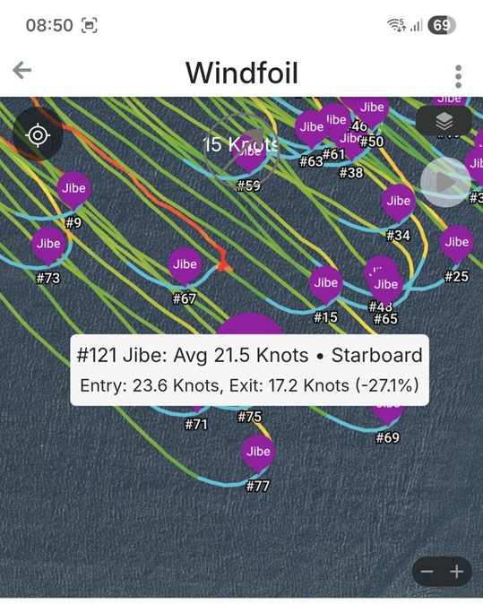
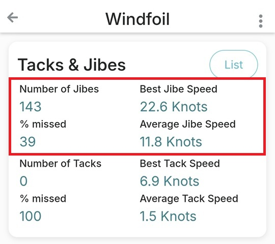
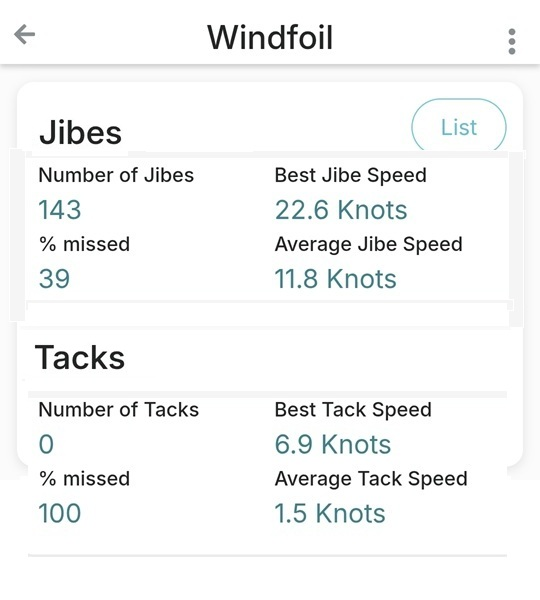

## Waterspeed - Tacks & Jibes

Author: Michael George

Date created: 23 Nov 2025

Last updated: 8 Nov 2026

### Introduction

The concepts relating to jibes and tacks are discussed in a more detailed document - see [link](README.md).

That document also discusses the importance of selecting suitable start and end points.

Some of the proposed metrics such as scores are also applicable to Waterspeed.

### Individual Jibes

Waterspeed currently shows the following gybe metrics:

- Average Speed
- Entry Speed
- Exit Speed
- Disparity (%) = (Exit Speed - Entry Speed) / Entry Speed

Aside from choosing suitable start / end points, some additional metrics would be appreciated:

- Min Speed = Slowest speed during the gybe
- Efficiency (%) = Exit Speed / Entry Speed
  - This should be capped at 100% to to prevent riders from gaming the system
- Retained Speed (%) = Minimum Speed / Entry Speed
  - This metric can never exceed 100%
- Score (integer) = (Average Speed * Efficiency * 5) + (Min Speed * 5)

Notes:
- Min Speed and Retained Speed are the key jibe metrics reported by [GpsarPro](https://gpsactionreplay.free.fr/) and [GPS Speedreader](https://github.com/prichterich/GPS-Speedreader)
- Min Speed is required for Retained Speed, and Retained Speed is required to calculate the Score
- This approach has already been successfully implemented by [speedsurf.app](https://speedsurf.app/)

### Session Summary

The session summary currently includes the four jibe metrics highlighted in red.

In addition to the Number of Jibes and % missed, it would be useful to see the following stats:

- Best Jibe Speed - already available
- Best Min Speed
- Best Retained Speed (%)
- Best Jibe Score

The concept of the best 5 gybes is also appealing to people in the Waterspeed group chat.

- 5 x Jibe Speed
- 5 x Min Speed
- 5 x Retained Speed (%)
- 5 x Jibe Score

The eight jibe metrics offer a range of different insights, each focusing on different aspects of jibing.

The existing metric "Average Jibe Speed" isn't particularly useful for windsurfing, perhaps not winging either?

Metrics for the best 5 jibes are less sensitive to fickle winds, and offer more insight than overall averages.

### Tacking

Everything discussed above also applies to tacking since all of the metrics are equally applicable.

The additional stats would make the Tacks & Jibes section rather cluttered, so probably worth splitting them apart.

This just illustrates the idea with the current stats, not showing the stats proposed earlier in this document.

